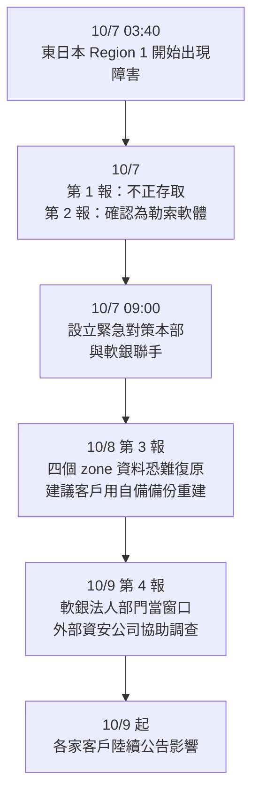
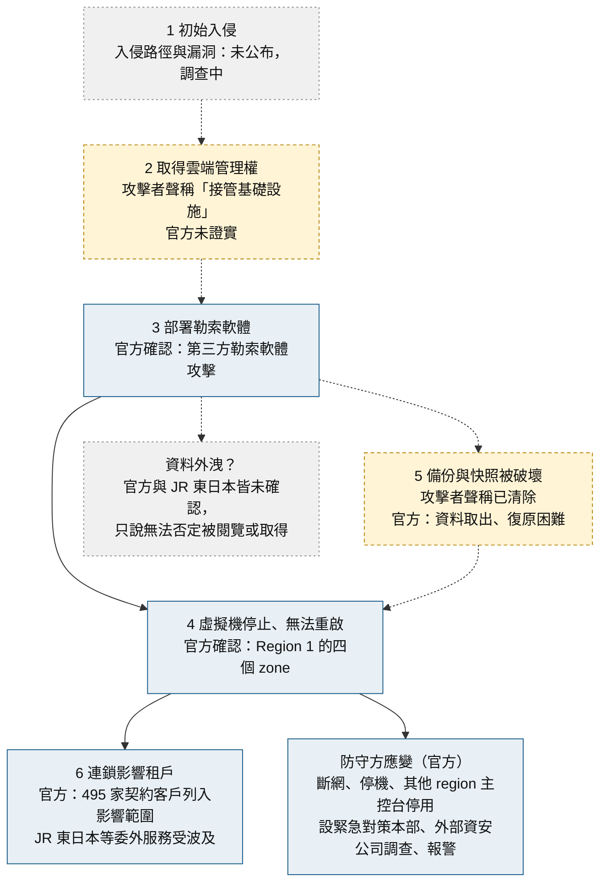
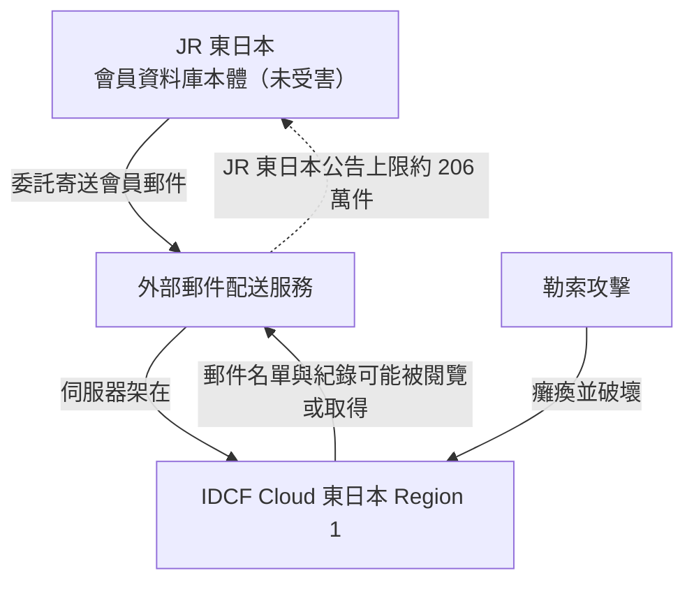

# 雲端房東被打掛，房客的資料呢？

2026 年 10 月 7 日清晨 3 點 40 分左右，日本軟銀（SoftBank）旗下的雲端業者 IDC Frontier（IDCF）開始出事，客戶的虛擬伺服器停止，也無法重新啟動。當天 IDCF 公告原因：[第三方的勒索軟體攻擊](https://www.idcf.jp/news/topics/20261007002)。

隔天的第 3 報給出最重的一句：四個區域（zone）裡的客戶資料「取出與復原的前景困難」，IDCF 目前的見解是[只能靠客戶自己手上的備份](https://www.idcf.jp/news/topics/20261008001)。截至 10 月 10 日，官方還沒有公布復原時程。

## 先把事實排好

下表只放 IDCF 自己在公告裡寫的內容，每一列都能回到[第 1 至第 4 報](https://www.idcf.jp/news/topics/)核對。

| 項目 | 官方說法 |
|---|---|
| 發生時間 | 2026 年 10 月 7 日（三）上午 3 點 40 分左右，公告時仍在持續 |
| 受害產品 | IDCF Cloud 東日本 Region 1 的一部分 |
| 受害的四個 zone | `tesla`、`henry`、`pascal`、`joule` |
| 現象 | 虛擬伺服器停止、無法重新啟動 |
| 原因 | 第三方的勒索軟體攻擊（第 2 報確認；第 1 報只寫「不正存取」） |
| 影響範圍 | 公告列的是「契約 IDCF Cloud 的 495 家企業與自治體」 |
| 資料前景 | 四個 zone 的客戶資料「取出與復原困難」；「現時點」的見解是只能靠客戶自備的備份 |
| 未確認受害 | `radian`、`newton` 兩個 zone，以及東日本 Region 2、3 和西日本 Region 1，目前未確認有不正存取；但 IDCF 仍請這些客戶自行備份，並陸續提供備份方法 |
| 不在事件範圍內 | IDCF Cloud TypeS（舊名 ASPIRE）與 IDCF 私有雲 |

**495 是契約客戶數，不是「確定資料被毀的客戶數」。** 第 2 報把它列在「影響範圍」底下，措辭是「契約 IDCF Cloud 的 495 家企業與自治體」。第 3 報的「對象」欄只列了 Region 1 的四個 zone，並說其他 zone 與 region 未確認有不正存取。所以 495 看起來是「需要個別聯絡的客戶總數」，實際資料出問題的，應該只是其中用到那四個 zone 的一部分，但官方沒有公布細分。

**「Region 1 在福島白河」是二手轉述。** 報導引用 IDCF 的規格頁，指東日本 Region 1 到 3 都在[福島白河資料中心](https://innovatopia.jp/cyber-security/cyber-security-news/118700/)。這點不影響事件判讀，但寫「受害的就是白河那一座」就過頭了。

## 時間軸

幾個細節：

- **斷網與停機**：第 2 報說 Region 1 已經[從網路切斷、系統停止](https://www.idcf.jp/news/topics/20261007002)。其他 region 的客戶管理主控台也一併停掉，等確認安全才恢復。這是為了防止擴大，不代表其他 region 出事。
- **客戶服務**：主控台停用期間，IDCF 受客戶要求代為開機、關機。[第 4 報](https://www.idcf.jp/news/topics/20261009001)說窗口是軟銀的法人部門，也提供備份步驟指引與遷移環境的提案。
- **調查**：IDCF 與外部資安公司合作調查，也已向監督省廳和警視廳報告。入侵路徑仍在查。

## 攻擊者說了什麼，哪些能信

**攻擊者的畫面和數字，不是官方確認的事實。**

媒體報導與社群流傳的截圖裡，有一段類似「雲端被我們接管」的訊息，還說只花了 7 分鐘就攻下 Region 1。BleepingComputer 的報導也[提到這段說法](https://www.bleepingcomputer.com/news/security/ransomware-attack-disrupts-japans-idcf-cloud-used-by-govt-clients/)。IDCF 表示已掌握攻擊者聲明的存在，真偽還在調查，官方沒有認可任何一個數字，見 [innovatopia 的整理](https://innovatopia.jp/cyber-security/cyber-security-news/118700/)。

另有一組更精細的數字在流傳，包括 239 台 hypervisor、225 個 datastore、約 3.6 PB、16,600 多個虛擬磁碟、554,153 筆快照、41.5 PB 備份。**這組數字沒有公開的原始來源，也沒有官方認可，請不要當成事實引用。**

### 數字本身站得住嗎

如果「7 分鐘加密 3.6 PB」是真的，等於 3.6 PB ÷ 420 秒，約 8.6 TB/s 的總寫入量，攤到 225 個 datastore 每個約 38 GB/s，遠超一般儲存陣列的水準。有人因此推測攻擊者採用的是只破壞虛擬磁碟檔頭或間隔區塊的間歇式（部分）加密。

這是本文依攻擊者數字做的算術推論。**官方沒有公布加密手法，也沒有鑑識報告**；數字若是誇大，推論就不成立。

### 誰幹的？

截至 10 月 10 日，沒有主流勒索軟體集團在洩露網站公開認領，也沒有公開的談判管道、贖金金額或錢包地址。坊間有「刻意羞辱」、「假旗行動」之類的猜測，沒有證據支撐。

## 攻擊鏈：已知與未知

官方沒有公布入侵路徑，所以完整的攻擊鏈畫不出來。下面把每一環標上證據強度：藍框是官方確認，黃框是攻擊者聲稱，灰框是未知或未確認；虛線箭頭表示先後順序只是推論。

| 階段 | 證據強度 | 依據 |
|---|---|---|
| 初始入侵 | 未知 | IDCF 第 3 報：「詳細な影響範囲や侵入経路等については調査中」；沒有公布 CVE |
| 取得管理權 | 攻擊者聲稱 | 媒體與社群流傳的主控台截圖出現「雲端被接管」類訊息，官方未認可內容 |
| 部署勒索軟體 | 官方確認 | [第 2 報](https://www.idcf.jp/news/topics/20261007002) |
| 虛擬機停止 | 官方確認 | [第 3 報](https://www.idcf.jp/news/topics/20261008001)：四個 zone 的虛擬伺服器停止且無法重啟 |
| 備份被破壞 | 聲稱＋推論 | 官方只說資料難以復原、只能靠客戶自備備份；「快照與備份被清除」是攻擊者聲稱的數字，沒有獨立證據。若屬實，代表客戶看得到的備份跟生產環境在同一個控制平面底下 |
| 租戶連鎖 | 官方確認 | 495 家列入影響範圍；JR 東日本、日水物流等案例見上節 |
| 資料外洩 | 未確認 | 官方沒有宣告外洩；JR 東日本稱無法否定被閱覽或取得 |

兩點補充：

- **「接管基礎設施」只能當聲稱。** 若屬實，代表攻擊者碰到的是管理層，而非個別客戶的虛擬機，四個 zone 同時倒下就說得通；但官方沒有證實。
- **各環節的先後順序是推論。** 官方只確認「發生時間 03:40」和「是勒索軟體」，攻擊者從入侵到加密之間做了什麼、花了多久，目前沒有可靠資料。

## 受害者的樣子

勒索軟體打的是雲端業者，倒楣的是一整串租戶。下面這些是有公開公告或報導可查的案例：

| 單位 | 發生了什麼 | 來源 |
|---|---|---|
| 茨城縣與縣警網站 | 一度無法瀏覽 | [innovatopia 引共同通信](https://innovatopia.jp/cyber-security/cyber-security-news/118700/) |
| 東京都小平市、東武動物公園、時事通信社 | 網站一度無法瀏覽或更新 | [nippon.com](https://www.nippon.com/en/news/yjj2026100700867/) |
| グリニッジ（Greenwich） | 庫存連動服務「らくらく在庫」等停擺 | [innovatopia](https://innovatopia.jp/cyber-security/cyber-security-news/118700/) |
| 日水物流（ニッスイ集團） | 出入庫作業受阻，10/9 起部分恢復；受害伺服器不含集團管理的個資與客戶資料 | [Nissui 公告](https://www.nissui.co.jp/news/20261009.html) |
| Six Apart（Movable Type 雲端版） | IDCF 方案 31 台伺服器受影響，10/8 21 點前全數暫時移到「さくらのクラウド」，用的是 10/7 凌晨 1 點的備份 | [Six Apart 第 3 報](https://www.sixapart.jp/movabletype/news/2026/10/09-0900.html) |
| UDトーク | 公開對話的 QR code 資訊遺失；單字登錄資料還在伺服器，但個人帳號因綁定的 email 消失而難以對應；預計 10/19 完全復旧 | [UDトーク 公告](https://udtalk.jp/a20261007/) |

Six Apart 是這批案例裡少數靠備份撐過來的。從事發到搬完約 41 小時，代價是備份點之後約 2 到 3 小時的資料沒帶過去，而且只是暫定措施，之後視客戶意願再搬回。公告沒有說備份存放在哪裡。

### JR 東日本的郵件名單風險

[JR 東日本在 10 月 9 日公告](https://www.jreast.co.jp/press/2026/20261009_ho02.pdf)，會員郵件配送用的外部服務受 IDCF 事件影響。原文沒有點名這家外部業者。依 [Impress Watch 的整理](https://www.watch.impress.co.jp/docs/news/2147202.html)：

- 「えきねっと」會員：最多約 **167 萬件**，內容僅限電子郵件地址
- 「大人の休日倶楽部」會員：最多約 **39 萬件**，內容含電子郵件地址、會員編號、信用卡有效期限、出生年月日
- 姓名、住址、電話、信用卡號都不在可能外洩的範圍裡
- 「尚未確認外流」，但無法否定部分郵件地址與郵件紀錄被第三方閱覽或取得

這裡的「最多 206 萬件」是兩項服務各自上限的**加總**，代表可能受影響的名單上限，不是已證實外洩的人數。「有效期限加生日」不足以盜刷，卻足夠讓釣魚信看起來像真的，收到「會員資料更新」之類的信要多看一眼。

JR 東日本自己的會員系統沒被打，被打的是**委外廠商租的雲端房東**。風險隔了兩層才落到它頭上。

View Card、JR 九州、Peach Aviation 等也有流傳的件數（例如 Peach 約 189 萬件），但沒有可核對的公開公告，本文不引用。

## 想求償？法律上不容易

以下是契約與法規的整理，**不構成法律意見**。

### IDCF 的契約約款怎麼寫

IDCF 的[雲端服務契約約款](https://www.idcf.jp/pdf/common/cloudservices.pdf)（Ver.6.3）第 29 條是免責條款，與這次事件有關的有四處：

1. **第 1 項第 2 款**：客戶管理或保管的資料外洩、滅失或消失所造成的損害，IDCF 不負責。
2. **第 1 項第 9 款**：IDCF 已盡善良管理人注意仍無法防禦的第三方不正存取或攻擊，所造成的損害不負責。
3. **第 3 項**：資料滅失或消失造成的損害、可得利益損失，IDCF 不負賠償責任。
4. **第 6 項**：因 IDCF 的故意或重大過失而**沒有提供服務**時，前五項規定不適用。

第 2 項另有但書：服務規格書訂有品質保證（SLA），或個別規程明定要賠的，不適用該項。

此外，約款的「バックアップ等」條文明定，客戶資料的備份由客戶自己負責，IDCF 對資料的保管、保存、備份不負責任，資料滅失、毀損造成的直接或間接損害也不賠。

所以客戶想求償，得先過這些免責條文：第 6 項只在「沒有提供服務」時才排除免責，資料滅失算不算「沒有提供服務」並不明確；就算適用，也只是拿掉免責的擋箭牌，還得證明 IDCF 有重大過失、損害與因果。不是說一定求償無門，但門檻高，且要看各客戶實際的契約版本與個別約定。

### 日本的個資與通報規定

這部分是一般法規知識，與本案的連結是推論：

- 《個人情報保護法》第 25 條要求委託個資處理時監督受託方；第 23 條是自身的安全管理措置義務。
- 發生涉及「不正目的」的外洩事態時，要向個人情報保護委員會（PPC）速報與確報，確報期限為 60 日內（依第 26 條與施行規則第 8 條）。
- 《電氣通信事業法》對重大事故有通報與報告義務，IaaS 是否構成「重大事故」要看主管機關認定。IDCF 第 3 報只說已向監督省廳和警視廳報告。
- 日本的集體訴訟制度（消費者裁判手續特例法）針對消費者，企業間糾紛不適用。企業受害方只能個別或以共同訴訟處理。

## 這件事帶走什麼

IaaS 的分工是：房東管大樓，房客管自己屋內的資料與備份，約款也這樣寫。這次房東的樓層被打掛，租戶只剩自己的備份。幾個具體的檢查項目：

1. **同平台的快照不算備份。** 快照跟主機放在同一個控制平面底下，控制平面被拿下，兩者一起沒。
2. **備份要跟生產環境分開。** Six Apart 能在約 41 小時內暫時恢復 31 台，是因為手上有事發前的備份，沒有跟著受害環境一起消失。
3. **備份要鎖死。** 如果備份帳號和生產環境用同一組權限，攻擊者拿到權限就能一起刪。可考慮不可變異（WORM）儲存，例如 AWS S3 Object Lock 的 Compliance 模式或 GCS Bucket Lock。這是通用做法，不是 IDCF 事件裡有人驗證過的對策。
4. **演練還原，不只備份。** 備份有沒有，和能不能在幾個小時內還原，是兩回事。
5. **盤點你的第四方。** 合約裡要問：我委外的廠商，資料實際跑在哪家的雲上？JR 東日本就是這樣中招的。
6. **管理介面不要裸露。** [JPCERT/CC 10 月的注意喚起](https://www.jpcert.or.jp/at/2026/at260030.html)談的是近期日本組織個資外洩的一般攻擊型態，包括管理用 API 的存取控制不足。**這份文件沒有提到 IDCF，不能當成本案的原因。** 但裡面的存取控制建議，對所有人都適用。

## 還沒有答案的事

- 入侵路徑：官方還在調查，沒有公布任何 CVE 或具體漏洞。
- 攻擊者身分與動機：沒有可信的歸因。
- 受害規模的細項：495 家裡有多少家的資料實際在四個 zone，官方沒有公布。
- 郵件名單等個資是否真的外流：目前都是「可能性」。
- 攻擊者宣稱的數字：沒有獨立證據。
- 復原時程：截至 10 月 10 日，官方尚未公布。
- 日本法規在本案的實際適用：要看主管機關後續的認定。

## 來源

**官方公告（第一手）**

- IDC Frontier [第 1 報（10/7）](https://www.idcf.jp/news/topics/20261007001)、[第 2 報（10/7）](https://www.idcf.jp/news/topics/20261007002)、[第 3 報（10/8）](https://www.idcf.jp/news/topics/20261008001)、[第 4 報（10/9）](https://www.idcf.jp/news/topics/20261009001)
- IDC Frontier [クラウドサービスに関する契約約款 Ver.6.3（PDF）](https://www.idcf.jp/pdf/common/cloudservices.pdf)
- 東日本旅客鉄道（JR 東日本）[2026/10/9 公告（PDF）](https://www.jreast.co.jp/press/2026/20261009_ho02.pdf)
- ニッスイ [日水物流株式会社におけるシステム障害について（第2報）](https://www.nissui.co.jp/news/20261009.html)，2026/10/9
- Six Apart [Movable Type クラウド版における IDCF クラウド障害の影響と対応について（第3報）](https://www.sixapart.jp/movabletype/news/2026/10/09-0900.html)，2026/10/9
- UDトーク [【重要】UDトークのシステム障害と復旧状況](https://udtalk.jp/a20261007/)，2026/10/7 起、10/9 更新
- JPCERT/CC [JPCERT-AT-2026-0030](https://www.jpcert.or.jp/at/2026/at260030.html)，2026/10/8 公開、10/9 更新（與 IDCF 無直接關係）

**媒體報導（可靠二手）**

- Impress Watch [JR東日本、「えきねっと」など206万件漏えいの可能性](https://www.watch.impress.co.jp/docs/news/2147202.html)
- innovatopia [IDCFクラウドにランサムウェア攻撃、495の企業・自治体に影響](https://innovatopia.jp/cyber-security/cyber-security-news/118700/)，2026/10/8
- nippon.com [Cyberattack on SoftBank Unit Affects Local Govt, Corporate Websites](https://www.nippon.com/en/news/yjj2026100700867/)，2026/10/7
- BleepingComputer [Ransomware attack disrupts Japan's IDCF Cloud used by govt clients](https://www.bleepingcomputer.com/news/security/ransomware-attack-disrupts-japans-idcf-cloud-used-by-govt-clients/)
